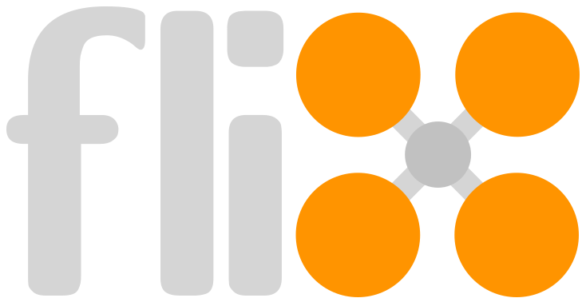

<!-- markdownlint-disable MD041 -->

<p align="center">
  <br>
  <b>Flix</b> — 基于 ESP32 的开源四旋翼飞控（改版）
</p>

* 本仓库仅为个人学习使用，无经营性。
* 提交很随意，想 push 就 push，有 bug 或者代码写一半也会提交，**请勿直接使用仓库代码**！

## 维护方向

本仓库的维护重心已从 CF-Drone 固件迁移到 [flix](flix) 固件：

* **`flix/` — 主要维护的飞控固件**（Arduino 工程位于 `flix/flix/`，构建入口为 `flix/Makefile`）
* `CF-Drone/` — 旧版固件，**已停止维护，已删除**
* `huojianfeikong/` — 早期第三方代码，不再维护

### flix 固件特性

* 遥控：SBUS、ELRS CRSF（ExpressLRS）
* 通信：Wi-Fi 热点 / STA / ESP-NOW，MAVLink 遥测（QGroundControl 可用）
* 网页遥控器：手机浏览器访问 `http://192.168.4.1`，支持深/浅色主题、多设备互斥、实体/网页控制优先级
* 可选气压定高（BMP581），编译开关见 `flix/flix/features.h`
* 电压/电流回传、遥控 LED、Gazebo 仿真、Python 工具链

### 资料

* 本仓库使用的第三方电路板开源：（原作者已经关闭了工程，正在解决）
* [电路板原作者B站主页 (非本仓库成员) https://space.bilibili.com/432749088](https://space.bilibili.com/432749088)
* 原 [songge8/CF-Drone](https://github.com/songge8/CF-Drone) 项目作者B站：[琛光E1_MINI](https://www.bilibili.com/video/BV18ho4BKEzt)，
其[硬件开源](https://oshwhub.com/songge8/project_qqqyfdkm)

## 快速开始

```bash
cd flix
make libs      # 安装 FlixPeriph / MAVLink / SparkFun BMP581 库
make build     # 编译
make upload    # 烧录
make monitor   # 串口监视（115200）
```

也可以直接用 Arduino IDE 打开 `flix/flix/flix.ino` 编译（库可从 Arduino 库管理器安装，或放在 `flix/flix/libraries/` 中随源码分发）。

Flix原始说明见 [flix/README.md](flix/README.md)、[flix/docs](flix/docs) 与 [flix/docs/usage.md](flix/docs/usage.md)。

## 版权与许可证

* SPDX-License-Identifier: GPL-3.0-or-later — 适用于本仓库的**原创修改部分**。
* `flix/` 目录基于 [okalachev/flix](https://github.com/okalachev/flix)：
  该上游仓库未附许可证（All rights reserved），本项目已获得原作者邮件授权，
  相关代码版权归原作者，原始版权声明保持不变。
* 随源码分发的第三方库（`flix/flix/libraries/`）：
  * FlixPeriph：MIT，Copyright (c) 2024 Oleg Kalachev
  * MAVLink：MIT，Copyright (c) 2024 Oleg Kalachev
* 本仓库的原创修改包括：ELRS CRSF 协议支持、遥控 LED、电压/电流回传、气压定高、网页遥控器等。
* 原 `CF-Drone/` 目录派生自 [songge8/CF-Drone](https://github.com/songge8/CF-Drone)，
  遵循 GPL-3.0-or-later 及其附加条款（著作权人：琛光科技 / CHERGLOWTECH），其具备一定参考价值，
  予以保留说明，本仓库的网页操控由DeepSeek重构，仅参考该项目
  **该目录已经删除，本仓库不再包含这部分代码。**

## 迁移说明

* 早期本仓库同时维护 `CF-Drone/` 与 `flix/` 两个固件目录，现已统一以 `flix/` 为准。
* 不再跟踪上游 `songge8/CF-Drone` 的更新。

## 更新

更新日志见 [NOTICE](NOTICE) 与提交记录。

## English

* This repository is for personal learning only. Do not use the code directly in production.
* Main firmware: [`flix/flix`](flix/flix). The old `CF-Drone/` folder is legacy and has been removed.
* `flix/` is based on [okalachev/flix](https://github.com/okalachev/flix), which has no license attached;
  authorization has been obtained from the original author and attribution is retained.
* Bundled third-party libraries are MIT-licensed (FlixPeriph, MAVLink).
* Original modifications are licensed under GPL-3.0-or-later.
* In case of ambiguity between Chinese and English, the Chinese version prevails.
